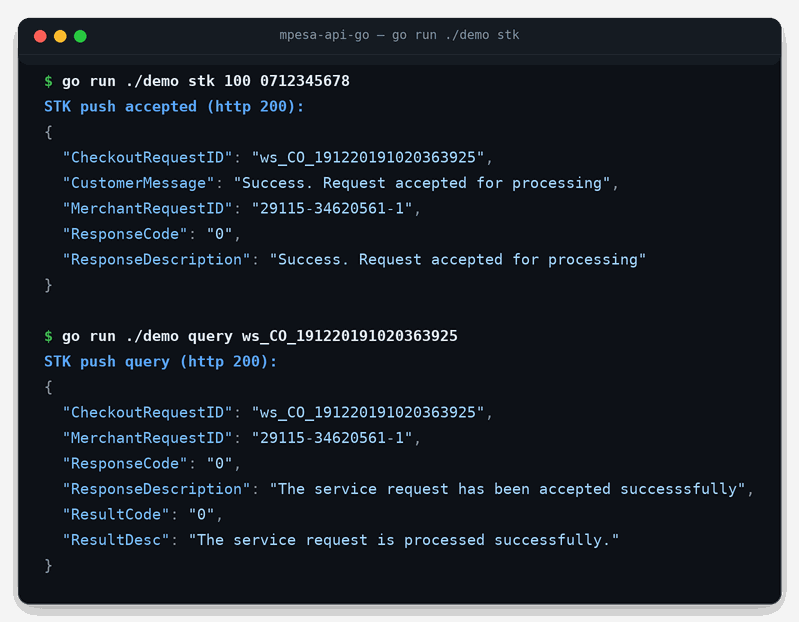
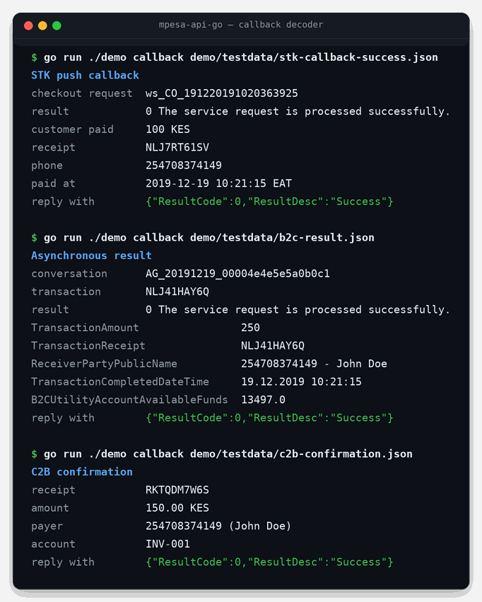
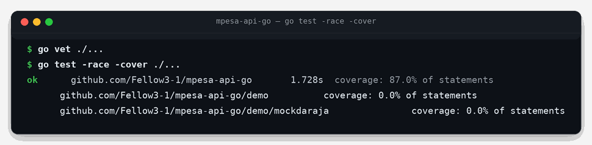

# mpesa-api-go

[](https://github.com/Fellow3-1/mpesa-api-go/actions/workflows/ci.yml)

An unofficial, dependency-free Go client for the [Safaricom Daraja (M-Pesa) API](https://developer.safaricom.co.ke/docs).

```go
client, err := mpesa.New(appKey, appSecret, mpesa.DEV,
	mpesa.WithShortCode("174379"),
	mpesa.WithPassKey(passKey),
)

res, err := client.STKPush(ctx, mpesa.STKPushRequest{
	Amount:           100,
	PhoneNumber:      "0712345678",
	CallBackURL:      "https://example.com/mpesa/callback",
	AccountReference: "INV-001",
	TransactionDesc:  "Invoice 001",
})
```

<p align="center">
  
</p>

> Real output from the demo CLI: an STK push is sent, then queried. The two
> commands are `go run ./demo stk 100 0712345678` and
> `go run ./demo query ws_CO_191220191020363925`, run against the mock Daraja API
> shipped in `demo/mockdaraja`.

## Features

- **Every common Daraja payment API**: Lipa na M-Pesa (STK push) and STK query, C2B
  registration and simulation, B2C, B2B, reversals, account balance, transaction
  status and dynamic QR codes.
- **Zero dependencies** – standard library only, `context` aware, safe for
  concurrent use.
- **Tokens handled for you** – OAuth tokens are cached until shortly before they
  expire, and a rejected token is refreshed and the request replayed once.
- **Typed requests and responses** with client-side validation: invalid payloads
  never reach the network and the error names the offending field.
- **Callback decoding** – the exact structures Safaricom posts for STK, C2B and
  asynchronous results (including queue timeouts), plus the acknowledgement
  payloads to reply with.
- **Helpers** – STK push password generation, EAT timestamps, Kenyan phone number
  normalisation and RSA security credentials for initiator protected APIs.
- **Safe retries** – opt-in, and only for responses that mean the request was not
  processed (429/502/503/504). Payment requests are never replayed blindly.

## Supported endpoints

| API | Method | Daraja endpoint |
| --- | --- | --- |
| OAuth token | `AccessToken` | `GET /oauth/v1/generate` |
| Lipa na M-Pesa (STK push) | `STKPush` | `POST /mpesa/stkpush/v1/processrequest` |
| STK push query | `STKPushQuery` | `POST /mpesa/stkpushquery/v1/query` |
| C2B URL registration | `RegisterC2BURLs` | `POST /mpesa/c2b/v1/registerurl` |
| C2B simulation (sandbox) | `SimulateC2B` | `POST /mpesa/c2b/v1/simulate` |
| B2C payment | `B2C` | `POST /mpesa/b2c/v1/paymentrequest` |
| B2B payment | `B2B` | `POST /mpesa/b2b/v1/paymentrequest` |
| Reversal | `Reversal` | `POST /mpesa/reversal/v1/request` |
| Account balance | `AccountBalance` | `POST /mpesa/accountbalance/v1/query` |
| Transaction status | `TransactionStatus` | `POST /mpesa/transactionstatus/v1/query` |
| Dynamic QR code | `GenerateQRCode` | `POST /mpesa/qrcode/v1/generate` |

Callbacks: `ParseSTKCallback`, `ParseC2BConfirmation`, `ParseResultCallback`.

## Installing

```sh
go get github.com/Fellow3-1/mpesa-api-go
```

Requires Go 1.22 or newer.

## Quick start

```go
package main

import (
	"context"
	"log"
	"os"
	"time"

	mpesa "github.com/Fellow3-1/mpesa-api-go"
)

func main() {
	client, err := mpesa.New(
		os.Getenv("MPESA_APP_KEY"),     // consumer key
		os.Getenv("MPESA_APP_SECRET"),  // consumer secret
		mpesa.DEV,                      // mpesa.PRODUCTION for live payments
		mpesa.WithShortCode(os.Getenv("MPESA_SHORT_CODE")),
		mpesa.WithPassKey(os.Getenv("MPESA_PASS_KEY")),
	)
	if err != nil {
		log.Fatal(err)
	}

	ctx, cancel := context.WithTimeout(context.Background(), 30*time.Second)
	defer cancel()

	res, err := client.STKPush(ctx, mpesa.STKPushRequest{
		Amount:           100,
		PhoneNumber:      "0712345678",
		CallBackURL:      "https://example.com/mpesa/callback",
		AccountReference: "INV-001",
		TransactionDesc:  "Invoice 001",
	})
	if err != nil {
		log.Fatal(err)
	}
	log.Printf("checkout request %s: %s", res.CheckoutRequestID, res.CustomerMessage)
}
```

`STKPushRequest` fills in the values Daraja derives from your configuration:
`BusinessShortCode` comes from `WithShortCode`, and `Password`/`Timestamp` are
generated from `WithPassKey` (`base64(shortCode + passKey + timestamp)` in EAT).
Provide them explicitly to override.

## Configuration

`New(appKey, appSecret string, env Env, opts ...Option)` accepts:

| Option | Purpose |
| --- | --- |
| `WithShortCode(code)` | Default pay bill/till number for requests that omit one. |
| `WithPassKey(key)` | Lipa na M-Pesa pass key used to build STK push passwords. |
| `WithCertificate(cert)` | Safaricom RSA certificate used to sign initiator protected requests. |
| `WithInitiatorPassword(pw)` | Initiator password encrypted into a `SecurityCredential`. |
| `WithHTTPClient(hc)` | Use a custom HTTP client (proxies, instrumentation, transport tuning). |
| `WithTimeout(d)` | Request timeout (default 30s). |
| `WithRetries(n)` | Retry retryable gateway errors (default 0 – see below). |
| `WithRetryBackoff(d)` | Base delay for the jittered exponential backoff. |
| `WithBaseURL(url)` | Point the client at a mock server, e.g. in tests. |
| `WithUserAgent(ua)` | Override the `User-Agent` header. |

Environments: `mpesa.DEV` (sandbox, the default) and `mpesa.PRODUCTION`.

## Authentication

`AccessToken` fetches `POST`-free OAuth tokens with HTTP Basic credentials, caches
them and refreshes them 60 seconds before expiry. Concurrent callers share one
token request, and if any API call is answered with `401` the client refreshes
the token and replays the request exactly once.

## Examples

### STK push query

```go
res, err := client.STKPushQuery(ctx, mpesa.STKPushQueryRequest{
	CheckoutRequestID: checkoutRequestID,
})
switch {
case res.Succeeded(): // ResultCode "0"
case res.Cancelled(): // ResultCode "1032"
case res.TimedOut(): // ResultCode "1037"
case res.Pending(): // no result yet, query again shortly
}
```

Queries are only reliable a few seconds after the push; prefer the callback when
you can receive it.

### B2C payment

The `SecurityCredential` is generated for you when the client has a certificate
and initiator password, otherwise pass one in the request.

```go
certPEM, err := os.ReadFile("SandboxCertificate.cer")
cert, err := mpesa.LoadCertificate(certPEM)

client, err := mpesa.New(appKey, appSecret, mpesa.DEV,
	mpesa.WithShortCode("600000"),
	mpesa.WithCertificate(cert),
	mpesa.WithInitiatorPassword(initiatorPassword),
)

res, err := client.B2C(ctx, mpesa.B2CRequest{
	InitiatorName:   "testapi",
	Amount:          250,
	PartyB:          "0712345678",
	Remarks:         "Refund",
	ResultURL:       "https://example.com/mpesa/result",
	QueueTimeOutURL: "https://example.com/mpesa/timeout",
})
```

### B2B, reversal, balance and status

```go
_, err = client.B2B(ctx, mpesa.B2BRequest{ /* ... */ })

_, err = client.Reversal(ctx, mpesa.ReversalRequest{
	InitiatorName:  "testapi",
	TransactionID:  "NLJ7RT61SV",
	Amount:         250,
	ReceiverParty:  "600000",
	ResultURL:      "https://example.com/mpesa/result",
	QueueTimeOutURL: "https://example.com/mpesa/timeout",
	Remarks:        "Duplicate payment",
})

_, err = client.AccountBalance(ctx, mpesa.AccountBalanceRequest{
	InitiatorName:   "testapi",
	Remarks:         "Daily balance",
	ResultURL:       "https://example.com/mpesa/result",
	QueueTimeOutURL: "https://example.com/mpesa/timeout",
})

_, err = client.TransactionStatus(ctx, mpesa.TransactionStatusRequest{
	InitiatorName:   "testapi",
	TransactionID:   "NLJ7RT61SV",
	Remarks:         "Status check",
	ResultURL:       "https://example.com/mpesa/result",
	QueueTimeOutURL: "https://example.com/mpesa/timeout",
})
```

### C2B URLs and simulation

```go
_, err = client.RegisterC2BURLs(ctx, mpesa.C2BRegisterRequest{
	ConfirmationURL: "https://example.com/mpesa/confirm",
	ValidationURL:   "https://example.com/mpesa/validate",
})

// Sandbox only; returns mpesa.ErrSandboxOnly in production.
_, err = client.SimulateC2B(ctx, mpesa.C2BSimulateRequest{
	Amount:        10,
	MSISDN:        "254708374149",
	BillRefNumber: "account-1",
})
```

### Dynamic QR code

```go
res, err := client.GenerateQRCode(ctx, mpesa.QRCodeRequest{
	MerchantName: "Example Shop",
	RefNo:        "INV-001",
	Amount:       120,
	TrxCode:      mpesa.QRTrxCodeBuyGoods,
})
image, err := base64.StdEncoding.DecodeString(res.QRCode) // PNG bytes
```

## Handling callbacks

Daraja does not sign callbacks, so always verify the amount, reference and
receipt against your own records before releasing goods or services.

```go
func stkCallback(w http.ResponseWriter, r *http.Request) {
	body, _ := io.ReadAll(r.Body)

	callback, err := mpesa.ParseSTKCallback(body)
	if err != nil {
		http.Error(w, "bad callback", http.StatusBadRequest)
		return
	}

	if callback.Succeeded() {
		receipt := callback.Metadata.MpesaReceiptNumber
		amount := callback.Metadata.Amount
		// mark the order as paid, then reply with the acknowledgement
	}

	writeJSON(w, http.StatusOK, mpesa.SuccessAck())
}
```

- **STK push**: `ParseSTKCallback`, with `Succeeded`, `Cancelled`, `TimedOut`,
  `Receipt` and the `Metadata` (amount, receipt, transaction date in EAT, phone).
- **C2B confirmation/validation**: `ParseC2BConfirmation` exposes the payer,
  amount (`Amount()`), MSISDN, bill reference and balance. Reply from a
  validation URL with `mpesa.SuccessAck()` to accept or `mpesa.FailureAck(reason)`
  to reject.
- **Asynchronous results** (B2C, B2B, reversal, balance, status):
  `ParseResultCallback` gives `Succeeded()`, `TimedOut()` (queue timeouts) and
  `Param("TransactionReceipt")` / `ParamFloat("TransactionAmount")` lookups.

## Errors

```go
_, err := client.STKPush(ctx, req)
switch {
case err == nil:
	// accepted, the outcome arrives on the callback URL
case errors.As(err, new(*mpesa.ValidationError)):
	// the request was never sent; err names the offending field
case errors.As(err, new(*mpesa.APIError)):
	// Daraja rejected the request (status code, errorCode, errorMessage, requestId)
default:
	// transport, context or decoding failure
}
```

`APIError` exposes `StatusCode`, `ErrorCode`, `ErrorMessage`, `RequestID` and the
raw `Body`. Sentinels: `ErrMissingCredentials`, `ErrInvalidEnvironment`,
`ErrSandboxOnly`, `ErrEmptyResponse`.

## Retries

Retries are **off by default**. Enable them with `WithRetries(n)`; they apply
only to `429`, `502`, `503` and `504` responses, which mean the request was not
processed. Timeouts, connection errors and `500` responses are returned
immediately because Safaricom may already have executed the payment – check the
transaction status instead of replaying it.

## Helpers

```go
mpesa.GenerateSTKPushPassword(shortCode, passKey, timestamp) // base64(shortCode+passKey+timestamp)
mpesa.FormatTimestamp(time.Now())                            // YYYYMMDDHHmmss in EAT
mpesa.NormalizePhoneNumber("0712 345 678")                   // 254712345678
mpesa.LoadCertificate(pemBytes)                              // Safaricom RSA certificate
mpesa.EncryptSecurityCredential(cert, initiatorPassword)     // base64 RSA PKCS#1 v1.5
```

Amounts are whole Kenya Shillings (`int64`).

## Demo

`demo/main.go` is a small CLI that exercises the package against the sandbox:

```sh
export MPESA_APP_KEY=... MPESA_APP_SECRET=... MPESA_SHORT_CODE=174379 \
       MPESA_PASS_KEY=... MPESA_CALLBACK_URL=https://example.com/cb
go run ./demo stk 10 0712345678
```

Run `go run ./demo` for the command list. Credentials are read from the
environment only.

### Without credentials

`demo/mockdaraja` is a tiny stand-in for the Daraja API so you can try the CLI,
inspect the exact payloads the client sends, or build against the library before
your sandbox app is approved:

```sh
go run ./demo/mockdaraja -addr 127.0.0.1:8099 &

MPESA_BASE_URL=http://127.0.0.1:8099 MPESA_APP_KEY=demo MPESA_APP_SECRET=demo \
  MPESA_SHORT_CODE=174379 MPESA_PASS_KEY=passkey \
  go run ./demo stk 100 0712345678
```

The mock logs every request (method, path, whether a bearer token was present)
and returns realistic static responses.

### Decoding callbacks

`go run ./demo callback <file>` parses a saved callback payload with
`ParseSTKCallback`, `ParseResultCallback` or `ParseC2BConfirmation` — whichever
matches — and prints what the library extracted, plus the acknowledgement to
reply with. Use `-` to read from stdin, which is handy for replaying a payload
captured from a real callback:

```sh
go run ./demo callback demo/testdata/stk-callback-success.json
cat payload.json | go run ./demo callback -
```

<p align="center">
  
</p>

> Real output from `go run ./demo callback demo/testdata/*.json`. The sample
> payloads live in [`demo/testdata`](demo/testdata).

## Development

```sh
make test    # go test -race ./...
make cover   # coverage summary
make check   # gofmt + go vet + tests
```

The suite is table driven and runs entirely against `httptest` servers, so no
network access or credentials are needed.

<p align="center">
  
</p>

## Versioning

This module started as a 2017 work-in-progress wrapper and was rewritten for
v1.0.0. If you used the old API:

| Old | New |
| --- | --- |
| `mpesa.New(key, secret, env)` | `mpesa.New(key, secret, env, opts...)` (returns `*Client`, validates credentials) |
| `STKPushSimulation(STKPush)` | `STKPush(STKPushRequest)` |
| `STKPushTransactionStatus(STKPush)` | `STKPushQuery(STKPushQueryRequest)` |
| `C2BSimulation(C2B)` | `SimulateC2B(C2BSimulateRequest)` |
| `B2CRequest(B2C)` | `B2C(B2CRequest)` |
| `B2BRequest(B2B)` | `B2B(B2BRequest)` |
| `Reversal(Reversal)` | `Reversal(ReversalRequest)` |
| `BalanceInquiry(BalanceInquiry)` | `AccountBalance(AccountBalanceRequest)` |
| `RegisterURL(RegisterURL)` | `RegisterC2BURLs(C2BRegisterRequest)` |

The old methods returned the raw JSON string and silently swallowed errors (they
returned `nil` errors when authentication failed) and sent the payload wrapped in
a JSON array; the rewrite returns typed responses, surfaces every error and posts
a single JSON object, which is what Daraja expects.

## License

[MIT](LICENSE)
